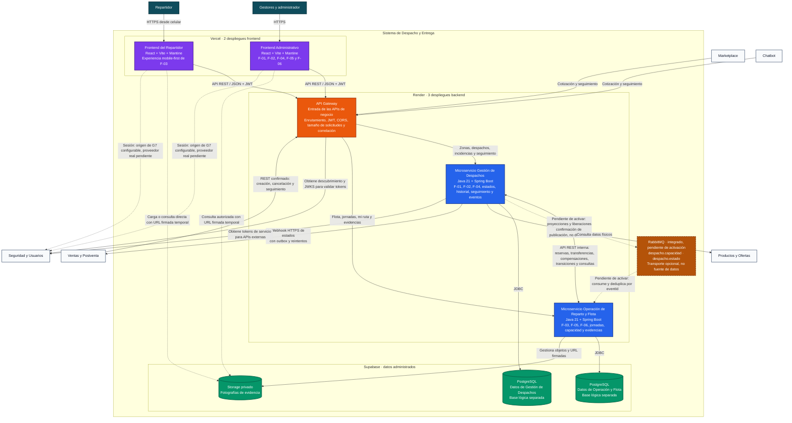

# Arquitectura C4: Diagrama de Contenedores

> **Estado:** Diseño actualizado conforme a `develop` (backend `859c5c3` y frontend `1bc5458`). RabbitMQ está integrado en el código, pero permanece deshabilitado por configuración y su activación está pendiente. Las decisiones técnicas abiertas se indican en la sección 8.

Este documento presenta el nivel 2 del modelo C4. Muestra una arquitectura con dos aplicaciones frontend, un API Gateway, dos microservicios, persistencia administrada, mensajería interna con RabbitMQ pendiente de activación y notificación asíncrona mediante webhook HTTPS con outbox.

RabbitMQ es un transporte **integrado y opcional**, no una fuente de datos. Mientras `RABBITMQ_HABILITADO=false`, los flujos internos correspondientes funcionan por HTTP. Al activarlo, Gestión publica las proyecciones del despacho y las liberaciones de capacidad que ya tienen adaptador de mensajería, y Operación las consume. Las operaciones que requieren respuesta inmediata conservan HTTP [cite: 4].

El [documento de API Management](./api-management-gateway.md) recoge el estado del Gateway y las políticas propuestas para autenticación, permisos, límites de solicitudes, red privada, catálogo y monitoreo.

## 1. Diagrama de contenedores



## 2. Catálogo de contenedores

| Contenedor | Responsabilidad | Tecnología | Despliegue | Dependencias directas |
|---|---|---|---|---|
| Frontend Administrativo | Experiencia para `GESTOR_DESPACHO`: zonas, tarifas, programación, incidencias, flota y jornadas | React 19, Vite, Mantine y TypeScript | Proyecto independiente en Vercel | API Gateway y, mediante URL firmada, Storage |
| Frontend del Repartidor | Ruta diaria, detalle, transiciones en campo, evidencia y cierre de jornada | React 19, Vite, Mantine y TypeScript; diseño mobile-first | Proyecto independiente en Vercel | API Gateway y, mediante URL firmada, Storage |
| API Gateway | Entrada pública de negocio. Enruta por capacidad, valida inicialmente el JWT, aplica CORS, controla el tamaño de solicitudes y propaga la correlación | Java 21 y Spring Cloud Gateway | Servicio independiente en Render | Seguridad y Usuarios, ambos microservicios |
| Microservicio Gestión de Despachos | Fuente única de zonas, tarifas y del estado del despacho. Aplica el límite vigente de cotizaciones y gestiona asignaciones, reprogramaciones, seguimiento, historial y eventos | Java 21, Spring Boot 4.1.3, Maven, Spring Web, Spring Security y JPA | Servicio independiente en Render | Su PostgreSQL, Operación de Reparto, Productos y Ofertas, Ventas y Postventa y, al activarse, RabbitMQ |
| Microservicio Operación de Reparto y Flota | Fuente única de repartidores, furgonetas, jornadas y capacidad; operación móvil y gestión de evidencias | Java 21, Spring Boot 4.1.3, Maven, Spring Web, Spring Security y JPA | Servicio independiente en Render | Su PostgreSQL, Storage, Gestión de Despachos, Seguridad y Usuarios y, al activarse, RabbitMQ |
| RabbitMQ (broker interno) | Transporte opcional para proyecciones y liberaciones de Gestión hacia Operación. No decide el estado del despacho ni conserva la verdad operativa | RabbitMQ con exchanges topic y DLX | Integrado en `develop`; **activación pendiente** en el entorno compartido | Gestión publica; Operación consume y registra `eventos_procesados` |
| Datos de Gestión de Despachos | Zonas, tarifas, despachos, historial, intentos, recepciones, idempotencia, bandeja de eventos salientes y solicitudes de liberación | PostgreSQL administrado por Supabase | Base lógica separada | Solo Gestión de Despachos |
| Datos de Operación y Flota | Repartidores, furgonetas, jornadas, reservas, proyección de ruta, evidencias y `eventos_procesados` | PostgreSQL administrado por Supabase | Base lógica separada | Solo Operación de Reparto y Flota |
| Storage de evidencias | Binarios de fotografías en un bucket privado; acceso temporal mediante URL firmada | Supabase Storage | Bucket privado | Operación de Reparto y clientes autorizados mediante URL temporal |

## 3. Responsabilidad de cada microservicio

### 3.1. Gestión de Despachos

Este microservicio responde **qué debe ocurrir con el paquete**. Es el único dueño del estado canónico del despacho y de su máquina de estados.

- F-01: zonas, tarifas, cobertura y cotización.
- F-02: recepción, cola, asignación, reasignación, secuencia y cancelación.
- F-04: recepción en el centro, reprogramación y cierre como `DEVUELTO_A_ORIGEN`.
- Requisitos transversales: máquina de estados, historial, seguimiento y eventos a Ventas y Postventa.

### 3.2. Operación de Reparto y Flota

Este microservicio responde **quién ejecuta la entrega, con qué recursos y qué ocurrió en campo**.

- F-03: ruta del repartidor, habilitación, inicio del traslado, entrega, fallo, cierre de jornada y evidencia.
- F-05: catálogo de repartidores y furgonetas y sus límites de carga.
- F-06: apertura y cierre de jornadas, monitoreo, disponibilidad, ocupación, reservas de capacidad y proyección operativa.

Cuando F-03 origina una transición, Operación de Reparto valida al repartidor, su jornada y la evidencia, y solicita el cambio a Gestión de Despachos por HTTP. Solo Gestión de Despachos modifica el estado canónico, el contador de intentos y el historial. El corte automático de jornadas anteriores es un proceso interno de Operación que resuelve los pendientes mediante las mismas transiciones HTTP [cite: 3].

## 4. Comunicaciones

La arquitectura utiliza REST para preguntas y comandos que necesitan una respuesta inmediata, y webhook HTTPS con outbox para comunicar a Ventas y Postventa hechos ya confirmados. RabbitMQ es un transporte opcional y aditivo para eventos internos entre Gestión y Operación, definido en el contrato externo §3.6. **Está integrado en el código, pero deshabilitado por configuración: su activación está pendiente.** Mientras tanto, HTTP es el mecanismo vigente para esos flujos [cite: 4].

| Interacción | Mecanismo | Motivo |
|---|---|---|
| Cotización y seguimiento | API REST síncrona mediante el Gateway | El canal necesita mostrar una respuesta inmediata al usuario. |
| Ventas solicita un despacho | `POST /api/v1/despachos` con `despachos:crear` e `Idempotency-Key` | Permite validar cobertura y devolver de inmediato el identificador y código de rastreo. |
| Ventas solicita una cancelación | `POST /api/v1/despachos/pedidos/{idPedido}/cancelacion` con `despachos:cancelar` e `Idempotency-Key` | Ventas necesita conocer si el estado actual todavía permite cancelar. |
| Despacho informa cambios de estado | Webhook HTTPS a `/api/v1/integraciones/despachos/eventos` con `ventas:pedidos:estado`, outbox, `idEvento` y reintentos | La notificación no bloquea ni revierte una transición local confirmada. |
| Gestión consulta, reserva o libera capacidad | API REST interna síncrona e idempotente | La asignación necesita confirmar en ese momento si existe capacidad. |
| Reparto solicita una transición de campo | API REST interna síncrona e idempotente | El repartidor necesita conocer el resultado de la operación. |
| Gestión comunica un estado confirmado a Reparto | API REST interna idempotente y versionada; alternativa RabbitMQ pendiente de activar | Mantiene la proyección sin compartir la base de datos. |
| Gestión notifica liberaciones y proyecciones internas | Actualmente HTTP; tras la activación, RabbitMQ en `despacho.capacidad` y `despacho.estado` (contrato externo §3.6) | El transporte asíncrono no bloquea la transición confirmada. HTTP no es un conmutador automático ante fallo: solo se recupera al cambiar configuración y drenar o conciliar lo publicado. |
| Seguridad entrega identidad, roles y scopes | JWT validado localmente mediante JWKS; token de servicio obtenido por `client_credentials` | Evita consultar Seguridad en cada petición protegida y separa usuarios humanos de clientes técnicos. |
| Alta y vinculación de un repartidor | `ADMIN_SISTEMA` crea la cuenta en Seguridad sin rol global; una operación administrativa vincula después el `usuario_id` con el perfil local | Despacho no crea cuentas, no administra contraseñas y autoriza al repartidor mediante el `sub` vinculado. |
| Carga de evidencia | URL firmada hacia Storage | La transferencia directa evita que el Gateway transporte archivos grandes. |

### 4.1. Webhook y bandeja de salida

El webhook no es un contenedor adicional: es una relación HTTPS saliente hacia Ventas y Postventa. Gestión de Despachos registra primero cada evento en su bandeja de salida dentro de la misma transacción del cambio de estado. Un proceso posterior realiza el envío y los reintentos conservando el mismo identificador idempotente. RabbitMQ no sustituye este webhook.

### 4.2. Transporte interno RabbitMQ

La topología se define en el [contrato externo §3.6](../integraciones/api-contract.md#36-mensajería-interna-con-rabbitmq) y no se duplica aquí:

| Exchange | Routing key publicada | Cola | Consumidor |
|---|---|---|---|
| `despacho.capacidad` (topic) | `operacion.liberacion.{idReserva}` | `operacion.liberaciones` | Operación |
| `despacho.estado` (topic) | `despacho.proyeccion` | `despacho.eventos.estado` | Operación |

Gestión declara los exchanges y publica desde sus bandejas durables; Operación declara las colas, los bindings, el dead-letter exchange `despacho.dlx` y las DLQ, y registra cada `eventId` en `eventos_procesados`.

La activación implica tres precisiones:

1. **Publicación aceptada no equivale a efecto aplicado.** El confirm del broker acredita que RabbitMQ aceptó el mensaje; no acredita que Operación haya liberado la reserva ni aplicado la proyección.
2. **No hay reintento automático de consumo.** Una excepción del listener envía el mensaje a la DLQ en el primer intento; las DLQ no son colas de reintento con TTL ni retorno automático.
3. **El retorno a HTTP no reabre automáticamente** registros marcados como enviados ni mensajes ya alojados en colas o DLQ; requiere drenaje y conciliación [cite: 4].

Estas limitaciones se registran como trabajo pendiente antes de activar el transporte en un entorno compartido.

## 5. Propiedad y aislamiento de datos

- Cada microservicio consulta únicamente su propia base lógica. En el entorno local se usan dos bases con una credencial común; el aislamiento por credenciales distintas es una condición del despliegue compartido que debe verificarse, no un hecho comprobado en Compose.
- Un microservicio no consulta tablas ni esquemas del otro y no existen claves foráneas cruzadas.
- RabbitMQ transporta copias de información, no transfiere propiedad: Gestión sigue siendo dueña del estado canónico y Operación de jornadas, reservas y proyecciones.
- Para el curso se puede utilizar un único proyecto de Supabase con dos esquemas aislados. Dos proyectos independientes ofrecen mayor aislamiento, pero también mayor costo operativo.
- Gestión de Despachos conserva identificadores externos de repartidor, jornada y reserva, no relaciones JPA hacia tablas de Operación de Reparto.
- Operación de Reparto puede mantener una proyección mínima de la ruta para lectura móvil, pero Gestión de Despachos conserva la verdad oficial del despacho.
- Supabase Auth no se utiliza: la autenticación y los roles pertenecen al módulo Seguridad y Usuarios.
- El Gateway valida la firma y vigencia del token como primera barrera; cada microservicio vuelve a validar el rol, la operación permitida y la propiedad del recurso.
- Las llamadas internas entre microservicios utilizan credenciales de servicio y no quedan expuestas como rutas públicas del Gateway.

## 6. Flujo candidato de evidencia fotográfica

1. El Frontend del Repartidor solicita al Gateway autorización para cargar una evidencia.
2. Operación de Reparto valida el JWT, el propietario del despacho, la jornada y el tipo esperado.
3. Operación de Reparto genera una autorización temporal de carga para el bucket privado.
4. El navegador carga el archivo directamente en Supabase Storage.
5. El frontend confirma la operación enviando la referencia de evidencia, no la fotografía en Base64.
6. Operación de Reparto valida la referencia y solicita a Gestión de Despachos la transición correspondiente.
7. Para visualizarla, un usuario autorizado recibe una URL firmada de corta vigencia.

Si la transición es rechazada, el objeto cargado queda temporalmente sin asociación y puede eliminarse mediante una tarea periódica. Esta propuesta supone Supabase Storage; el mecanismo continúa sujeto a la decisión pendiente de F-03.

## 7. Organización de repositorios y despliegues

La cantidad de repositorios no tiene que coincidir con la cantidad de aplicaciones o microservicios. La propuesta conserva tres repositorios y utiliza los repositorios de implementación como monorepos.

```text
G2-Despacho-Specs/
└── documentación funcional, C4, contratos y decisiones

frontend/
├── apps/
│   ├── despacho-administrativo/
│   └── despacho-repartidor/
└── packages/
    ├── componentes-compartidos/
    ├── cliente-api/
    └── tipos-compartidos/

backend/
├── api-gateway/                  # proyecto Maven independiente
├── servicio-gestion-despachos/   # proyecto Maven independiente
├── servicio-operacion-reparto/   # proyecto Maven independiente
├── compose.yaml                  # incluye el broker para desarrollo local
└── init-db.sql
```

| Repositorio | Aplicaciones | Despliegues previstos |
|---|---|---|
| `G2-Despacho-Specs` | Documentación | Sin despliegue de ejecución |
| `frontend` | Frontend Administrativo y Frontend del Repartidor | Dos proyectos en Vercel |
| `backend` | API Gateway y dos microservicios | Tres servicios en Render |

Cada aplicación debe tener su propio archivo de configuración, variables de entorno, pruebas y comando de construcción. Los paquetes compartidos del frontend contienen componentes visuales y tipos, pero no reglas de negocio. En backend se pueden compartir convenciones técnicas mínimas; no se comparte el modelo JPA ni el acceso a datos.

### 7.1. Configuración mínima por despliegue

| Despliegue | Directorio raíz sugerido | Configuración externa necesaria |
|---|---|---|
| Vercel: Administrativo | `apps/despacho-administrativo` | URL pública del API Gateway |
| Vercel: Repartidor | `apps/despacho-repartidor` | URL pública del API Gateway; la autorización temporal de Storage se recibe desde la API |
| Render: API Gateway | `api-gateway` | URL interna de ambos microservicios, origen CORS permitido y datos para validar tokens de Seguridad |
| Render: Gestión de Despachos | `servicio-gestion-despachos` | Conexión PostgreSQL propia, URL interna de Operación de Reparto, URL de Productos, URL del webhook de Ventas, credenciales de servicio y, al activarse, conexión y credenciales del broker |
| Render: Operación de Reparto y Flota | `servicio-operacion-reparto` | Conexión PostgreSQL propia, URL interna de Gestión de Despachos, URL de Seguridad, credenciales privadas de Storage y, al activarse, conexión y credenciales del broker |
| Broker (activación pendiente) | Servicio administrado externo a Render | Dirección y puerto AMQP, credenciales de publicación y consumo, y verificación de la migración V8 de Operación antes de publicar |

Los secretos de base de datos, claves de servicio, credenciales del broker y credenciales privadas de Storage se configuran únicamente en el entorno de servidor. Nunca se incorporan al código fuente ni a las variables públicas de Vercel.

En local, Compose levanta siete servicios: PostgreSQL, RabbitMQ, Seguridad temporal, Ventas temporal, Gestión, Operación y Gateway. El broker se inicia aunque `RABBITMQ_HABILITADO=false`: la opcionalidad es de uso por las aplicaciones, no de aprovisionamiento del contenedor. En el entorno publicado, la existencia de un broker debe comprobarse antes de activar el flag [cite: 4].

## 8. Decisiones vigentes y puntos que el equipo debe cerrar

| Decisión | Recomendación para discutir | Cuándo cambiarla |
|---|---|---|
| URL y seguridad del webhook | Ruta confirmada `/api/v1/integraciones/despachos/eventos`; token de `modulo-despacho` con `aud=api-ventas` y `ventas:pedidos:estado`; outbox e idempotencia por `idEvento` | Cambiar únicamente mediante una nueva versión acordada con Ventas |
| Alta y vinculación de repartidores | `ADMIN_SISTEMA` crea la cuenta global y Despacho conserva solamente el vínculo local con `usuario_id` | Completar el canal administrativo para comunicar el identificador y gestionar altas o bajas globales |
| Comunicación entre microservicios | APIs REST internas idempotentes, autenticadas y versionadas para todo comando o consulta con respuesta inmediata | Ajustar solamente si cambia el contrato interno |
| Mensajería interna RabbitMQ | Código integrado y deshabilitado por configuración. Activar únicamente tras cerrar la semántica de confirmación de liberación, la atomicidad de la deduplicación, la detección de mensajes no enrutables, la política de reintentos y DLQ, y la conciliación ante un retorno a HTTP | Cambiar el flag y documentar la nueva topología efectiva solo con evidencia de la activación |
| Redis | No incluirlo todavía | Incorporarlo si se requiere rate limiting global con varias instancias, caché compartida o coordinación distribuida medida |
| Base de datos | Un proyecto Supabase con dos esquemas y credenciales aisladas para el curso | Separar proyectos si se necesita aislamiento físico o despliegue realmente independiente |
| Evidencias | Evaluar Supabase Storage privado con URL firmada | Cambiar si F-03 define otro proveedor o procesamiento especializado |
| Autenticación | Consumir JWT de Seguridad; no usar Supabase Auth | Cambiar únicamente por acuerdo con Seguridad y Usuarios |
| Mapas, GPS y optimización | No mostrarlos como contenedores actuales | Incorporarlos cuando entren formalmente al alcance funcional |

Redis no se agrega solo por utilizar microservicios; se incorporará únicamente si aparece una necesidad medida de caché compartida, rate limiting distribuido o coordinación entre instancias.

## 9. Referencias

[cite: 3] [Contrato de Operación §5.4 y proceso de corte](../integraciones/api-contract-operacion-reparto.md#54-gestión-consulta-repartidores-y-jornadas-de-incidencias), con la verificación local registrada en [ES-F03-07](../especificaciones/ES-F03-07-CierreJornada/evidence.md).

[cite: 4] [Backend `develop`, commit `859c5c3`](https://github.com/Taller-SW-Web/G2-Despacho-Backend/tree/859c5c37abd6f9543c70d6c7f456b3d7d651435a): código de mensajería interna, `compose.yaml` y topología de Operación. La integración del código no acredita la activación del broker.
