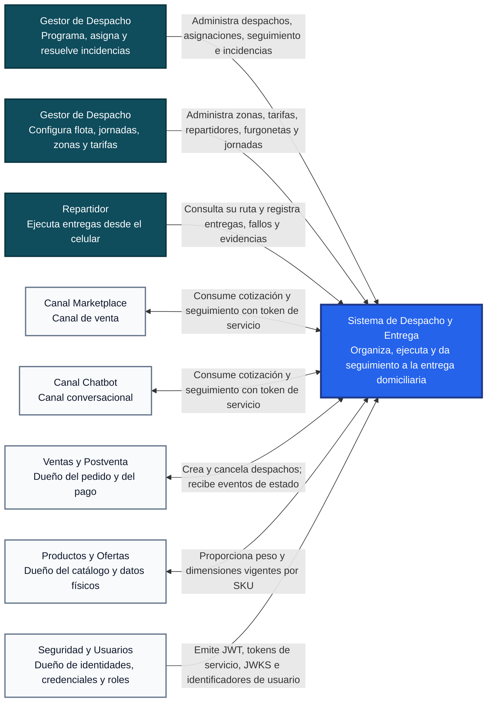

# Arquitectura C4: Diagrama de Contexto

> **Estado:** Contexto general alineado con `overview.md` e `integraciones/api-contract.md`. Los aspectos operativos aún abiertos se indican en la sección 5.

Este documento presenta el nivel 1 del modelo C4 del Sistema de Despacho y Entrega a Domicilio. Su objetivo es mostrar, sin detalles técnicos de implementación, quiénes utilizan el sistema, con qué sistemas externos se integra y qué información intercambia con cada uno. Los mecanismos de comunicación se alinean con `integraciones/api-contract.md`.

## 1. Diagrama de contexto

## 2. Personas y responsabilidades

| Persona | Qué entrega al sistema | Qué recibe del sistema |
|---|---|---|
| Gestor de Despacho | Decisiones de asignación, reasignación, recepción, reprogramación y cierre | Cola de despachos, capacidad disponible, estado, historial y alertas de incidencias |
| Gestor de Despacho | Datos de zonas, tarifas, repartidores, furgonetas y jornadas | Ocupación de flota, disponibilidad, conflictos y auditoría de configuración |
| Repartidor | Inicio del traslado, resultado de la entrega, fotografía, motivo de fallo y cierre de jornada | Ruta ordenada, detalle del destinatario mientras corresponde, confirmaciones y resumen diario |

## 3. Sistemas externos e intercambios

| Sistema externo | Información recibida por Despacho | Información enviada por Despacho | Mecanismo | Funcionalidad relacionada |
|---|---|---|---|---|
| Canal Marketplace | Destino y líneas (`sku`, `cantidad`) para cotizar; `idPedido` para seguimiento | Cobertura, costo, plazo y estado resumido sin coordenadas ni datos personales | API REST síncrona directa con `cotizaciones:calcular` o `seguimientos:leer` y `aud=api-despacho` | F-01, seguimiento transversal |
| Canal Chatbot | Destino y líneas (`sku`, `cantidad`) para cotizar; `idPedido` para seguimiento | Cobertura, costo, plazo y estado resumido sin coordenadas ni datos personales | API REST síncrona directa con `cotizaciones:calcular` o `seguimientos:leer` y `aud=api-despacho` | F-01, seguimiento transversal |
| Ventas y Postventa | Pedido pagado con paquete preparado y sellado, destinatario, destino y líneas (`sku`, `cantidad`); solicitudes de cancelación | Identificador del despacho y siete tipos de evento logístico mediante el webhook confirmado | REST síncrono con `despachos:crear`, `despachos:cancelar` o `seguimientos:leer`; webhook HTTPS hacia `/api/v1/integraciones/despachos/eventos` con `ventas:pedidos:estado` | F-02, F-04, eventos transversales |
| Productos y Ofertas | Peso en kilogramos y dimensiones en centímetros vigentes por SKU | Consulta en lote de los SKU incluidos en la cotización o el pedido | `POST /api/v1/productos/datos-fisicos/consulta` con `aud=api-productos` y `productos:fisicos:leer` | F-01, F-02 |
| Seguridad y Usuarios | JWT, tokens de servicio, JWKS e identificadores de usuario | No recibe una solicitud automática de alta desde Despacho; una persona con `ADMIN_SISTEMA` crea la cuenta y Despacho vincula localmente su `usuario_id` | OAuth 2.0 `client_credentials`, descubrimiento/JWKS y vinculación administrativa local | Todas, especialmente F-03 y F-05 |

## 4. Límites del contexto

- El sistema es dueño de los despachos, las zonas y tarifas, la operación de reparto, la flota y las evidencias.
- Ventas y Postventa conserva la propiedad del pedido, el pago, las anulaciones comerciales, los reembolsos y los reclamos.
- Productos y Ofertas conserva la propiedad del catálogo, el stock y los datos físicos de los productos.
- Seguridad y Usuarios conserva la propiedad de las identidades, credenciales y roles.
- Marketplace y Chatbot son canales consumidores; no crean directamente la entidad despacho.
- No existe integración con Retail dentro del alcance vigente.
- No se incluyen mapas, navegación, GPS, notificaciones al cliente ni optimización automática de rutas porque no forman parte de F-01 a F-05.

## 5. Acuerdos externos y aspectos operativos pendientes

Ya están confirmados el consumo directo de Marketplace y Chatbot, la integración bidireccional con Ventas y Postventa, la consulta física a Productos y la estructura de los tokens de servicio. No quedan decisiones funcionales abiertas en esas relaciones.

Permanecen como actividades operativas:

1. Registrar o verificar en Seguridad las concesiones de scopes para cada `client_id`, incluida `despachos:cancelar` para `modulo-ventas`, `ventas:pedidos:estado` para `modulo-despacho` y `productos:fisicos:leer` para `modulo-despacho`.
2. Configurar por ambiente las URL, credenciales y secretos, sin incorporarlos al repositorio.
3. Ejecutar pruebas de contrato entre los módulos consumidores y proveedores.
4. Publicar el procedimiento administrativo definitivo para comunicar a Despacho el `usuario_id` creado por `ADMIN_SISTEMA`, así como el contrato RabbitMQ de eventos de usuario.

## 6. Regla de lectura

Este diagrama responde únicamente a las preguntas **quién usa el sistema** y **con qué otros sistemas se comunica**. Vercel, Render, Supabase, las aplicaciones frontend, el API Gateway y los microservicios pertenecen al nivel de contenedores y se muestran en `c4-contenedores.md`.
