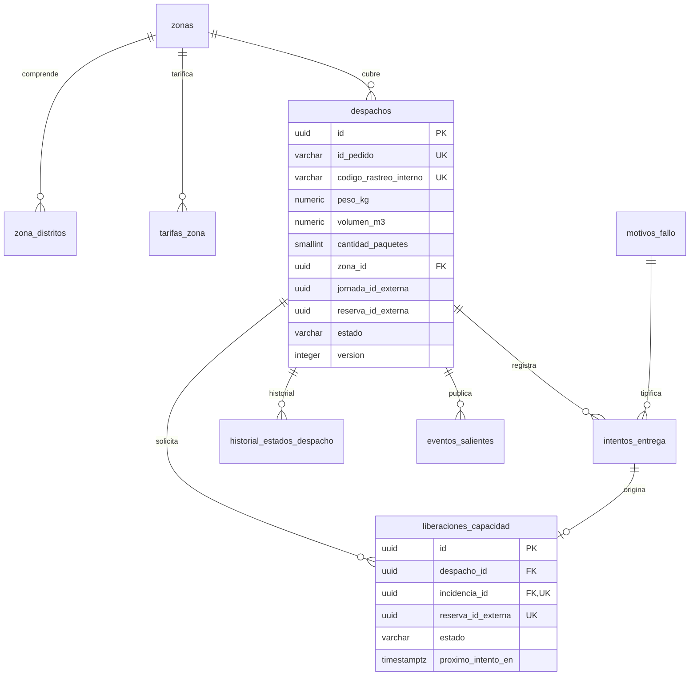
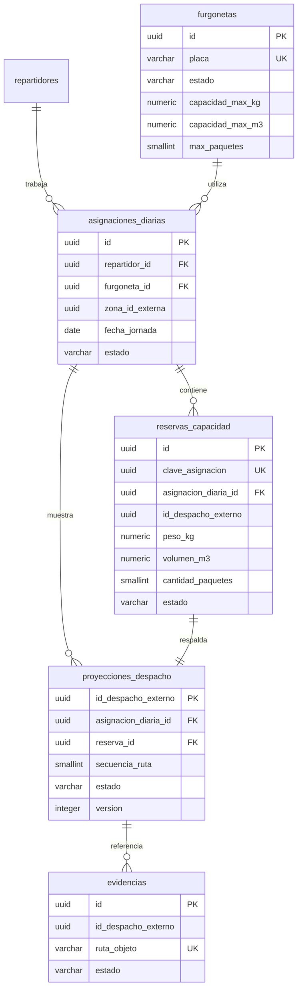

# Modelo de Datos: Módulo de Despacho y Entrega a Domicilio

Este documento define el modelo relacional de los dos microservicios del módulo de Despacho y Entrega, derivado de F-01 a F-05, de los requisitos transversales RT-01 a RT-04 del [overview](../overview.md), del [contrato de API](../integraciones/api-contract.md) y del [C4 de contenedores](./c4-contenedores.md).

- **Gestión de Despachos:** F-01, F-02 y F-04; es dueño de zonas, tarifas, despacho canónico, intentos, recepción en centro, historial y eventos.
- **Operación de Reparto y Flota:** F-03, F-05 y F-06; es dueño de repartidores, furgonetas, jornadas, reservas de capacidad, proyección móvil y evidencias.

Cada microservicio usa una credencial de base de datos distinta. Para el curso pueden emplearse dos esquemas aislados en un mismo proyecto de Supabase, pero un servicio no consulta las tablas del otro y no existen claves foráneas ni relaciones JPA entre esquemas.

---

## 1. Decisiones de diseño

| Tema | Decisión | Motivo |
|---|---|---|
| Motor | PostgreSQL 15/16 en Supabase | Cada microservicio conserva su persistencia aislada. |
| Persistencia | Dos esquemas o bases lógicas aisladas | Evita compartir tablas y modelos JPA entre microservicios. |
| Claves primarias | `UUID` generado con `gen_random_uuid()` | Los identificadores se exponen en APIs y eventos; no revelan volumen de operación ni son predecibles. |
| Código operativo | Columna única `codigo_rastreo_interno` | Facilita la operación interna; los canales consultan por `idPedido`. |
| Enumeraciones | `VARCHAR` con restricción `CHECK` | Se mapean directo con `@Enumerated(EnumType.STRING)` en JPA y son más simples de migrar que los tipos `ENUM`. |
| Borrado | Lógico, mediante columnas de estado (`estado_registro`, `activo`) | Repartidores, furgonetas y zonas con historial no pueden eliminarse. |
| Fechas | `TIMESTAMPTZ` en UTC para marcas temporales; `DATE` para jornadas y fechas programadas | La jornada se calcula en la zona horaria `America/Lima`. |
| Concurrencia | Columna `version` en `despachos` para bloqueo optimista (`@Version`) | Requerido por RT-01 y por las asignaciones de F-02. |
| Referencias entre servicios | Identificadores externos sin FK | Se validan mediante las APIs internas. |
| Datos derivados | La ocupación se calcula desde reservas de capacidad almacenadas por Operación | F-05 no consulta la tabla de despachos de Gestión. |
| Evidencias | Se guarda la ruta del objeto en el bucket privado, nunca el binario ni una URL | Las URL firmadas se emiten bajo demanda (F-03 RF-09). |
| Nomenclatura | `snake_case`, tablas en plural, columnas de auditoría `creado_en`, `actualizado_en`, `creado_por`, `actualizado_por` | Convención del repositorio. |

### 1.1. Cantidad de paquetes

Ventas y Postventa no informa `cantidadPaquetes`. Para el alcance inicial, cada pedido genera un despacho y un único paquete lógico, por lo que Gestión registra internamente `cantidad_paquetes=1`. Las líneas recibidas (`sku`, `cantidad`) representan productos y unidades, no bultos físicos.

Gestión conserva este valor para que Operación lo utilice, junto con el peso y el volumen calculados a partir de los datos físicos de Productos, al reservar capacidad en la furgoneta. Admitir más de un bulto por pedido requerirá una ampliación explícita del contrato; no debe inferirse desde la cantidad de productos.

---

## 2. Diagramas entidad-relación

Las líneas siguientes representan únicamente relaciones dentro de cada persistencia. Los identificadores que cruzan de un servicio a otro no son claves foráneas.

### 2.1. Gestión de Despachos



### 2.2. Operación de Reparto y Flota



Las tablas de soporte también son locales a cada servicio. No existe una tabla compartida de idempotencia, configuración o auditoría.

---

## 3. Catálogo de tablas

Cada tabla indica qué microservicio y funcionalidad la escriben. Una funcionalidad del otro servicio accede mediante API o mediante una proyección, nunca con SQL directo.

### 3.1. Zonas y tarifas (Gestión de Despachos; escribe F-01)

#### `zonas`
| Columna | Tipo | Restricciones | Descripción |
|---|---|---|---|
| `id` | `UUID` | PK | Identificador. |
| `nombre` | `TEXT` | NOT NULL, UNIQUE | Nombre de la zona ("Lima Centro"). |
| `estado` | `TEXT` | NOT NULL, CHECK (ver §4: `ACTIVO`, `INACTIVO`) | Solo las zonas activas se cotizan y aceptan despachos. |
| `origen_delimitacion` | `TEXT` | NULL | Origen de la delimitación. |
| `geom` | `extensions.geometry(Geometry, 4326)` | NULL | Geometría de la zona. |
| `creado_en` | `TIMESTAMPTZ` | NOT NULL, DEFAULT now() | Auditoría. |
| `actualizado_en` | `TIMESTAMPTZ` | NOT NULL, DEFAULT now() | Auditoría (actualizado por trigger). |
| `creado_por` | `UUID` | NULL | Identificador de usuario de Seguridad. |
| `actualizado_por` | `UUID` | NULL | Identificador de usuario de Seguridad. |

Índice: `idx_zonas_geom` (GiST sobre `geom`).

#### `distrito`
| Columna | Tipo | Restricciones | Descripción |
|---|---|---|---|
| `id` | `UUID` | PK | Identificador. |
| `nombre` | `TEXT` | NOT NULL | Nombre del distrito. |
| `provincia` | `TEXT` | NULL | Provincia. |
| `departamento` | `TEXT` | NULL | Departamento. |
| `ubigeo` | `TEXT` | UNIQUE | Código UBIGEO. |
| `geom` | `extensions.geometry(Geometry, 4326)` | NULL | Geometría del distrito. |
| `creado_en` | `TIMESTAMPTZ` | NOT NULL, DEFAULT now() | Auditoría. |
| `actualizado_en` | `TIMESTAMPTZ` | NOT NULL, DEFAULT now() | Auditoría (actualizado por trigger). |

Índice: `idx_distrito_geom` (GiST sobre `geom`).

#### `zonas_distritos`
| Columna | Tipo | Restricciones | Descripción |
|---|---|---|---|
| `id` | `UUID` | PK | Identificador. |
| `zona_id` | `UUID` | FK → `zonas.id`, NOT NULL | Zona a la que pertenece. |
| `distrito_id` | `UUID` | FK → `distrito.id`, NOT NULL | Distrito al que pertenece. |
| `codigo_postal` | `TEXT` | NULL | Código postal, si aplica. |
| `creado_en` | `TIMESTAMPTZ` | NOT NULL, DEFAULT now() | Auditoría. |
| `actualizado_en` | `TIMESTAMPTZ` | NOT NULL, DEFAULT now() | Auditoría (actualizado por trigger). |
| | | UNIQUE (`zona_id`, `distrito_id`) | Evita duplicar la misma asociación. |

Índice: `idx_zonas_distritos_distrito` sobre (`distrito_id`).
#### `zona_conflictos_log`
| Columna | Tipo | Restricciones | Descripción |
|---|---|---|---|
| `id` | `UUID` | PK | Identificador. |
| `nombre_intentado` | `TEXT` | NULL | Nombre intentado. |
| `zona_conflicto_id` | `UUID` | FK → `zonas.id` | Zona en conflicto. |
| `motivo` | `TEXT` | NULL | Motivo del conflicto. |
| `detalle` | `TEXT` | NULL | Detalle. |
| `intentado_en` | `TIMESTAMPTZ` | NOT NULL, DEFAULT now() | Momento del intento. |
| `intentado_por` | `UUID` | NULL | Usuario que lo intentó. |
| `creado_en` | `TIMESTAMPTZ` | NOT NULL, DEFAULT now() | Auditoría. |
| `actualizado_en` | `TIMESTAMPTZ` | NOT NULL, DEFAULT now() | Auditoría (actualizado por trigger). |

Índice: `idx_zona_conflictos_log_zona` (`zona_conflicto_id`).

#### `tarifas_zona`
| Columna | Tipo | Restricciones | Descripción |
|---|---|---|---|
| `id` | `UUID` | PK | Identificador. |
| `zona_id` | `UUID` | FK → `zonas.id`, NOT NULL | Zona tarificada. |
| `tarifa_base` | `NUMERIC(12,2)` | NOT NULL, CHECK (≥ 0) | Tarifa base. |
| `peso_base_kg` | `NUMERIC(10,2)` | NULL, CHECK (> 0) | Peso incluido en la tarifa base. |
| `recargo_kg_adicional` | `NUMERIC(12,2)` | NULL, CHECK (≥ 0) | Recargo por kg adicional. |
| `factor_volumetrico` | `NUMERIC(10,2)` | NULL, CHECK (> 0) | Factor volumétrico (kg/m³) para cálculo. |
| `moneda` | `TEXT` | NULL | Moneda (ej. `PEN`, `USD`). |
| `plazo_min_dias` | `INTEGER` | NULL | Plazo mínimo en días hábiles. |
| `plazo_max_dias` | `INTEGER` | NULL | Plazo máximo en días hábiles. |
| `activa` | `BOOLEAN` | NOT NULL, DEFAULT true | Tarifa vigente. |
| `creado_en` | `TIMESTAMPTZ` | NOT NULL, DEFAULT now() | Auditoría. |
| `creado_por` | `UUID` | NULL | Usuario que creó la tarifa. |
| `actualizado_en` | `TIMESTAMPTZ` | NOT NULL, DEFAULT now() | Auditoría (actualizado por trigger). |

Índice: `idx_tarifas_zona_zona` sobre (`zona_id`).


### 3.2. Flota y capacidad (Operación de Reparto y Flota; escribe F-05)

#### `repartidores`

| Columna | Tipo | Restricciones | Descripción |
|---|---|---|---|
| `id` | `UUID` | PK | Identificador (`idRepartidor`). |
| `nombres`, `apellidos` | `VARCHAR(80)` | NOT NULL | Datos personales. |
| `dni` | `VARCHAR(12)` | NOT NULL, UNIQUE | Documento de identidad (F-05 CA-02). |
| `telefono` | `VARCHAR(20)` | NOT NULL | Contacto. |
| `correo` | `VARCHAR(120)` | NOT NULL, UNIQUE | Identifica al repartidor y permite coordinar administrativamente su cuenta global. |
| `numero_brevete` | `VARCHAR(20)` | NOT NULL | Licencia de conducir. |
| `turno_habitual` | `VARCHAR(10)` | NOT NULL, CHECK (`MANANA`, `TARDE`, `COMPLETO`) | Turno de referencia. |
| `estado_registro` | `VARCHAR(10)` | NOT NULL, CHECK (`ACTIVO`, `INACTIVO`) | Baja lógica. |
| `id_usuario_seguridad` | `UUID` | NULL, UNIQUE | Usuario propiedad de Seguridad y Usuarios. |
| `estado_vinculacion` | `VARCHAR(15)` | NOT NULL, CHECK (`PENDIENTE`, `VINCULADO`) | Solo `VINCULADO` permite abrir una jornada. No replica el estado global de la cuenta. |
| `vinculado_en` | `TIMESTAMPTZ` | NULL | Momento en que se asoció el `usuario_id` de Seguridad. |
| Auditoría | — | NOT NULL | `creado_en`, `actualizado_en`, `creado_por`, `actualizado_por`. |

Flujo acordado:

1. Operación crea el perfil local del repartidor con `estado_vinculacion=PENDIENTE` y sin credenciales.
2. Una persona con rol `ADMIN_SISTEMA` crea la cuenta en Seguridad mediante su procedimiento administrativo, omitiendo un rol global de repartidor. La activación de credenciales pertenece por completo a Seguridad.
3. El canal administrativo acordado comunica a Despacho el `usuario_id` creado.
4. Operación guarda el valor en `id_usuario_seguridad`, registra `vinculado_en` y cambia el vínculo local a `VINCULADO`.
5. Cuando llega un JWT humano, el claim `sub` se resuelve contra `id_usuario_seguridad`; el estado local, la jornada y la propiedad de los recursos determinan la autorización.

Despacho no solicita automáticamente la creación de la cuenta, no utiliza un scope para crear repartidores y nunca almacena ni recibe la contraseña. El estado de activación, bloqueo o desactivación global pertenece a Seguridad y no se replica en `estado_vinculacion`; cuando se publique el contrato RabbitMQ, sus eventos permitirán reaccionar a esos cambios sin convertirlos en estados locales de vinculación.

La baja local mediante `estado_registro=INACTIVO` impide jornadas y asignaciones. Bloquear el acceso de la cuenta es una operación distinta que pertenece a Seguridad.

#### `furgonetas`

| Columna | Tipo | Restricciones | Descripción |
|---|---|---|---|
| `id` | `UUID` | PK | Identificador. |
| `placa` | `VARCHAR(10)` | NOT NULL, UNIQUE | Placa (F-05 CA-06). |
| `estado` | `VARCHAR(20)` | NOT NULL, CHECK (`DISPONIBLE`, `EN_MANTENIMIENTO`, `INACTIVA`) | `INACTIVA` es la baja lógica. |
| `capacidad_max_kg` | `NUMERIC(10,3)` | NOT NULL, CHECK (> 0) | Límite de peso. |
| `capacidad_max_m3` | `NUMERIC(10,4)` | NOT NULL, CHECK (> 0) | Límite de volumen. |
| `max_paquetes` | `SMALLINT` | NOT NULL, CHECK (> 0) | Máximo de paquetes en poder del repartidor. |
| Auditoría | — | NOT NULL | Igual que `repartidores`. |

#### `asignaciones_diarias`

Representa la jornada de un repartidor: con qué furgoneta y en qué zona trabaja ese día. Reemplaza a la tabla `turnos_operador` de la versión anterior.

| Columna | Tipo | Restricciones | Descripción |
|---|---|---|---|
| `id` | `UUID` | PK | Identificador de la jornada. |
| `repartidor_id` | `UUID` | FK → `repartidores`, NOT NULL | Repartidor. |
| `furgoneta_id` | `UUID` | FK → `furgonetas`, NOT NULL | Furgoneta. |
| `zona_id_externa` | `UUID` | NOT NULL, sin FK | Zona propiedad de Gestión de Despachos. |
| `fecha_jornada` | `DATE` | NOT NULL | Día de la jornada. |
| `capacidad_max_kg`, `capacidad_max_m3`, `max_paquetes` | Igual que `furgonetas` | NOT NULL | Copia de los límites al abrir la jornada. |
| `estado` | `VARCHAR(10)` | NOT NULL, CHECK (`ACTIVA`, `CERRADA`) | Una jornada cerrada deja al repartidor `FUERA_DE_TURNO`. |
| `abierta_en`, `abierta_por` | — | NOT NULL | Apertura por `GESTOR_DESPACHO`. |
| `cerrada_en` | `TIMESTAMPTZ` | NULL | Momento del cierre. |
| `tipo_cierre` | `VARCHAR(25)` | NULL, CHECK (`REPARTIDOR`, `CORTE_AUTOMATICO`, `GESTOR_DESPACHO`, `MANTENIMIENTO`) | Quién o qué cerró la jornada. |

Índices únicos parciales: un repartidor y una furgoneta tienen como máximo una jornada activa por fecha (`(repartidor_id, fecha_jornada)` y `(furgoneta_id, fecha_jornada)` WHERE `estado = 'ACTIVA'`).

### 3.3. Despachos (Gestión de Despachos; escribe F-02 y transiciona RT-01)

#### `despachos`
| Columna | Tipo | Restricciones | Descripción |
|---|---|---|---|
| `id` | `UUID` | PK | Identificador (`idDespacho`). |
| `pedido_id` | `UUID` | NOT NULL | Pedido de Ventas y Postventa (sin FK entre bases). |
| `zona_id` | `UUID` | FK → `zonas.id` | Zona resuelta. |
| `codigo_rastreo_interno` | `TEXT` | UNIQUE | Referencia operativa. |
| `es_simulado` | `BOOLEAN` | NOT NULL, DEFAULT false | Despacho de prueba; no emite eventos. |
| `estado` | `TEXT` | NOT NULL, CHECK (ver §4) | Estado actual. |
| `destinatario_nombre` | `TEXT` | NULL | Nombre del destinatario. |
| `destinatario_telefono` | `TEXT` | NULL | Teléfono de contacto. |
| `direccion` | `TEXT` | NULL | Dirección de entrega. |
| `referencia` | `TEXT` | NULL | Referencia de la dirección. |
| `distrito` | `TEXT` | NULL | Distrito. |
| `codigo_postal` | `TEXT` | NULL | Código postal. |
| `latitud` | `NUMERIC(9,6)` | NULL | Coordenada latitud. |
| `longitud` | `NUMERIC(9,6)` | NULL | Coordenada longitud. |
| `peso_kg` | `NUMERIC(10,2)` | NULL, CHECK (> 0) | Peso total calculado. |
| `volumen_m3` | `NUMERIC(10,3)` | NULL, CHECK (> 0) | Volumen total calculado. |
| `cantidad_paquetes` | `INTEGER` | NULL, CHECK (= 1) | Paquete lógico registrado internamente. |
| `fecha_comprometida` | `DATE` | NULL | Fecha comprometida (si se conserva como referencia). |
| `fecha_programada` | `DATE` | NULL | Fecha programada calculada por Despacho. |
| `en_cola_desde` | `TIMESTAMPTZ` | NULL | Última entrada a `PENDIENTE_ASIGNACION`. |
| `repartidor_id_externo` | `UUID` | NULL | Repartidor (BD 1). |
| `asignacion_diaria_id_externa` | `UUID` | NULL | Jornada (BD 1). |
| `reserva_capacidad_id_externa` | `UUID` | NULL | Reserva (BD 1). |
| `secuencia_ruta` | `INTEGER` | NULL, CHECK (> 0) | Posición en ruta. |
| `numero_intentos` | `INTEGER` | NOT NULL, DEFAULT 0 | Contador de intentos. |
| `ultima_incidencia_id` | `UUID` | FK → `intentos_entrega.id`, NULL al crear | Registro de la última transición aceptada a `FALLIDO`, incluido `NO_INTENTADO`; referencia local de Gestión. |
| `pedido_anulado_en` | `TIMESTAMPTZ` | NULL | Momento de anulación registrada. |
| `version` | `INTEGER` | NOT NULL, DEFAULT 1 | Bloqueo optimista. |
| `creado_en` | `TIMESTAMPTZ` | NOT NULL, DEFAULT now() | Auditoría. |
| `actualizado_en` | `TIMESTAMPTZ` | NOT NULL, DEFAULT now() | Auditoría (actualizado por trigger). |

Índices: `idx_despachos_pedido` (`pedido_id`), `idx_despachos_zona` (`zona_id`), `idx_despachos_estado` (`estado`).

### 3.4. Intentos y trazabilidad (Gestión de Despachos)

#### `motivos_fallo` (catálogo canónico consumido por F-03)
| Columna | Tipo | Restricciones | Descripción |
|---|---|---|---|
| `codigo` | `TEXT` | PK | Código del motivo. |
| `etiqueta` | `TEXT` | NOT NULL | Texto mostrado. |
| `seleccionable_en_campo` | `BOOLEAN` | NOT NULL, DEFAULT true | `false` para `NO_INTENTADO`. |
| `consume_intento` | `BOOLEAN` | NOT NULL, DEFAULT true | `false` para `NO_INTENTADO`. |
| `activo` | `BOOLEAN` | NOT NULL, DEFAULT true | Permite retirar motivos sin borrarlos. |
| `creado_en` | `TIMESTAMPTZ` | NOT NULL, DEFAULT now() | Auditoría (agregada). |
| `actualizado_en` | `TIMESTAMPTZ` | NOT NULL, DEFAULT now() | Auditoría (agregada, actualizado por trigger). |

Datos iniciales: los siete motivos del Anexo B de F-03.

#### `intentos_entrega` (Gestión persiste los resultados de F-03; F-04 completa la recepción)
| Columna | Tipo | Restricciones | Descripción |
|---|---|---|---|
| `id` | `UUID` | PK | Identificador. |
| `despacho_id` | `UUID` | FK → `despachos.id`, NOT NULL | Despacho. |
| `asignacion_diaria_id_externa` | `UUID` | NULL | Jornada de Operación. |
| `repartidor_id_externo` | `UUID` | NULL | Repartidor ejecutor. |
| `reserva_capacidad_id_externa` | `UUID` | NULL para datos históricos pendientes de regularizar | Instantánea de la reserva de esa salida; obligatoria para nuevos fallos, incluido `NO_INTENTADO`, sin FK entre servicios. |
| `resultado` | `TEXT` | NOT NULL | Resultado (`ENTREGADO`, `FALLIDO`). |
| `motivo_codigo` | `TEXT` | FK → `motivos_fallo.codigo`, NULL | Motivo cuando aplica. |
| `consume_intento` | `BOOLEAN` | NOT NULL, DEFAULT true | Indica si consume intento. |
| `comentario` | `TEXT` | NULL | Comentario del repartidor. |
| `nombre_receptor` | `TEXT` | NULL | Nombre de quien recibió. |
| `evidencia_id_externa` | `UUID` | NULL | Evidencia (BD 1). |
| `origen` | `TEXT` | NULL | Origen. |
| `registrado_en` | `TIMESTAMPTZ` | NOT NULL, DEFAULT now() | Momento de registro. |
| `recibido_en_centro_en` | `TIMESTAMPTZ` | NULL | Confirmación de retorno al centro. |
| `recibido_por` | `UUID` | NULL | Usuario que recibió en centro. |
| `sello_intacto` | `BOOLEAN` | NULL | Estado del sello. |
| `observacion_recepcion` | `TEXT` | NULL | Observación de recepción. |
| `creado_en` | `TIMESTAMPTZ` | NOT NULL, DEFAULT now() | Auditoría. |
| `actualizado_en` | `TIMESTAMPTZ` | NOT NULL, DEFAULT now() | Auditoría (actualizado por trigger). |

Índices: `idx_intentos_entrega_despacho` (`despacho_id`), `idx_intentos_entrega_motivo` (`motivo_codigo`).

Para ES-F04-01/02, `despachos.ultima_incidencia_id` se actualiza en la misma transacción que acepta cada transición a `FALLIDO`, apuntando a un registro de ese mismo despacho. Todo despacho vigente en `FALLIDO` debe tener esa referencia. La reprogramación y el cierre conservan el registro y su referencia para consultar el detalle histórico; un fallo posterior crea otro registro y sustituye la referencia, por lo que no hereda la recepción anterior. La lectura usa el identificador del registro como `idIncidencia`, independientemente de si consume un intento. No se usa `numero_intentos` ni un desempate de fechas para identificar la última incidencia.

El listado selecciona una fila por despacho a partir de esa referencia. Los datos de recepción y evidencia pertenecen al mismo registro; los campos `consume_intento` y `numero_intentos` representan, respectivamente, la condición de esa salida y el acumulado del despacho. La FK se incorpora una vez creadas ambas tablas; no introduce relaciones entre microservicios.

Operación provee nombres y cierre de jornadas mediante su lectura por lotes, §5.4. Gestión expone `DESCONOCIDA` ante una caída. Al aceptar cada fallo copia también la reserva de la asignación en la incidencia; una reasignación/reprogramación posterior no modifica esa referencia. ES-F04-03 utiliza esa instantánea y la solicitud durable de abajo; nunca obtiene la reserva de una salida posterior. Referencia: [Operación](../integraciones/api-contract-operacion-reparto.md#54-gestión-consulta-repartidores-y-jornadas-de-incidencias), [recepción de Gestión](../integraciones/api-contract-gestion-despachos.md#521-confirmar-recepción-en-centro--es-f04-03).

#### `liberaciones_capacidad` (Gestión de Despachos; solicitud durable de ES-F04-03)

| Columna | Tipo | Restricciones | Descripción |
|---|---|---|---|
| `id` | `UUID` | PK | Identificador de solicitud. |
| `despacho_id` | `UUID` | FK → `despachos.id`, NOT NULL | Despacho recibido. |
| `incidencia_id` | `UUID` | FK → `intentos_entrega.id`, NOT NULL, UNIQUE | Una solicitud por incidencia recibida. |
| `reserva_id_externa` | `UUID` | NOT NULL, UNIQUE | Reserva original de Operación; nunca se sustituye durante reintentos. |
| `jornada_id_externa` | `UUID` | NOT NULL | Jornada original de la incidencia. |
| `solicitada_por` | `UUID` | NOT NULL | `sub` del Gestor que confirmó. |
| `version_solicitada` | `INTEGER` | NOT NULL, CHECK (> 0) | Versión presentada al confirmar. |
| `hash_contenido` | `TEXT` | NOT NULL | Identidad del cuerpo normalizado para reconocer reintentos y rechazar contenido diferente. |
| `respuesta_original` | `JSONB` | NOT NULL | Cuerpo original del `202`; se conserva después de completar para reconocer una repetición del ejecutor original. |
| `estado` | `TEXT` | NOT NULL, CHECK (`PENDIENTE`, `CONFIRMADA`) | Estado de sincronización; no es un estado nuevo del despacho. |
| `requiere_revision` | `BOOLEAN` | NOT NULL, DEFAULT false | Error de credenciales, referencia o respuesta que necesita revisión operativa; la solicitud no se descarta. |
| `intentos_envio` | `INTEGER` | NOT NULL, DEFAULT 0, CHECK (>= 0) | Intentos iniciados por el procesador. |
| `proximo_intento_en` | `TIMESTAMPTZ` | NOT NULL mientras está pendiente; NULL al confirmar | Calendario durable de reintentos. |
| `ultimo_intento_en`, `confirmada_en` | `TIMESTAMPTZ` | NULL hasta que corresponda | Último envío y confirmación local de liberación. |
| `ultimo_codigo_error` | `TEXT` | NULL | Clasificación técnica sin tokens ni cuerpos de error externos. |
| `bloqueada_hasta`, `token_procesamiento` | `TIMESTAMPTZ`, `UUID` | NULL sin procesamiento | Exclusión temporal y propietario del intento; no se conserva una transacción abierta durante HTTP. |
| `creado_en`, `actualizado_en` | `TIMESTAMPTZ` | NOT NULL | Auditoría técnica del envío. |

Recepción, historial, incremento de `despachos.version` y solicitud se guardan en una sola transacción local. La incidencia debe tener reserva/jornada/repartidor coherentes antes de aceptar; datos históricos incompletos se regularizan desde información verificable, sin seleccionar la reserva actual por conjetura. La recepción y su solicitud no se eliminan al reprogramar o cerrar.

El procesador reclama pendientes vencidas con exclusión de 60 segundos, confirma esa reclamación y realiza HTTP con límite total de cinco segundos fuera de la transacción. Completa el intento solo si conserva el token; tras caída, otra instancia puede retomarlo cuando vence la exclusión. La idempotencia de Operación por reserva hace segura una entrega repetida. Al confirmar no se crea otro historial de recepción ni cambia la versión del despacho; solo se actualiza esta solicitud. Calendario y estados de consulta: [Gestión §5.2.1](../integraciones/api-contract-gestion-despachos.md#521-confirmar-recepción-en-centro--es-f04-03).

Índices: unicidad de incidencia/reserva y `(estado, proximo_intento_en, bloqueada_hasta)` para el procesador. Esta bandeja interna es independiente de `eventos_salientes` hacia Ventas; no comparte su máximo de cinco reintentos.

#### `evidencias` (Operación de Reparto y Flota; escribe F-03)

| Columna | Tipo | Restricciones | Descripción |
|---|---|---|---|
| `id` | `UUID` | PK | Identificador. |
| `despacho_id_externo` | `UUID` | NOT NULL, sin FK | Despacho canónico de Gestión. |
| `ruta_objeto` | `VARCHAR(300)` | NOT NULL, UNIQUE | Ruta en el bucket privado. |
| `tipo` | `VARCHAR(10)` | NOT NULL, CHECK (`ENTREGA`, `FALLO`) | Propósito autorizado. |
| `tipo_mime` | `VARCHAR(30)` | NOT NULL, CHECK (`image/jpeg`, `image/png`, `image/webp`) | Tipo de archivo. |
| `tamano_bytes` | `INTEGER` | NOT NULL, CHECK (> 0 y ≤ 2 097 152) | Máximo 2 MB (F-03 CA-18). |
| `estado` | `VARCHAR(12)` | NOT NULL, CHECK (`AUTORIZADA`, `CARGADA`, `ASOCIADA`, `EXPIRADA`) | Ciclo de la evidencia. |
| `cargado_por` | `VARCHAR(64)` | NOT NULL | Usuario repartidor. |
| `autorizada_en`, `cargado_en`, `asociada_en` | `TIMESTAMPTZ` | — | Marcas del ciclo. |
| `expira_en` | `TIMESTAMPTZ` | NOT NULL | Limpieza de cargas no asociadas. |

Si Gestión acepta la transición, Operación cambia la evidencia a `ASOCIADA`. Una tarea elimina objetos vencidos que nunca se asociaron.

#### `reservas_capacidad` (Operación de Reparto y Flota)

| Columna | Tipo | Restricciones | Descripción |
|---|---|---|---|
| `id` | `UUID` | PK | Identificador de reserva. |
| `clave_asignacion` | `UUID` | NOT NULL, UNIQUE | `Idempotency-Key` de la operación de asignación; se conserva con la reserva, incluso liberada, para no depender solo de una caché temporal. |
| `despacho_id_externo` | `UUID` | NOT NULL | Despacho de Gestión. |
| `asignacion_diaria_id` | `UUID` | FK → `asignaciones_diarias`, NOT NULL | Jornada que transportará el paquete. |
| `peso_kg` | `NUMERIC(10,3)` | NOT NULL, CHECK (> 0) | Peso reservado. |
| `volumen_m3` | `NUMERIC(10,4)` | NOT NULL, CHECK (> 0) | Volumen reservado. |
| `cantidad_paquetes` | `SMALLINT` | NOT NULL, CHECK (> 0) | Bultos reservados. |
| `estado` | `VARCHAR(10)` | NOT NULL, CHECK (`ACTIVA`, `LIBERADA`) | Ocupación vigente. |
| `motivo_liberacion` | `VARCHAR(30)` | NULL | Entrega, cancelación, recepción, reasignación o compensación. |
| `creado_en`, `liberado_en` | `TIMESTAMPTZ` | — | Auditoría. |
| `version` | `INTEGER` | NOT NULL, DEFAULT 0 | Control de concurrencia. |

Un índice único parcial sobre `despacho_id_externo WHERE estado = 'ACTIVA'` garantiza una sola reserva vigente y permite conservar las reservas históricas. Un despacho `FALLIDO` conserva la reserva hasta que Gestión confirme su recepción en el centro. La reprogramación no reutiliza una reserva liberada: crea otra al volver a asignar el despacho.

#### `proyecciones_despacho` (Operación de Reparto y Flota)

| Columna | Tipo | Restricciones | Descripción |
|---|---|---|---|
| `despacho_id_externo` | `UUID` | PK | Despacho canónico de Gestión. |
| `id_pedido` | `VARCHAR(50)` | NOT NULL | Referencia del pedido. |
| `codigo_rastreo_interno` | `VARCHAR(20)` | NOT NULL | Referencia operativa. |
| `asignacion_diaria_id` | `UUID` | FK → `asignaciones_diarias`, NOT NULL | Jornada actual. |
| `reserva_capacidad_id` | `UUID` | FK → `reservas_capacidad`, NOT NULL, UNIQUE | Reserva que sustenta la ruta. |
| `secuencia_ruta` | `SMALLINT` | NOT NULL, CHECK (> 0) | Orden. |
| `estado` | `VARCHAR(25)` | NOT NULL | Copia del estado confirmado por Gestión. |
| `destinatario_nombre`, `destinatario_telefono` | `VARCHAR` | NOT NULL | Datos necesarios para entregar. |
| `direccion`, `referencia`, `distrito` | `VARCHAR` | — | Destino operativo. |
| `fecha_programada` | `DATE` | NOT NULL | Fecha de ruta. |
| `numero_intentos` | `SMALLINT` | NOT NULL | Contador confirmado. |
| `version` | `INTEGER` | NOT NULL | Versión canónica aplicada. |
| `actualizado_en` | `TIMESTAMPTZ` | NOT NULL | Última sincronización. |

La proyección permite que F-03 lea la ruta sin consultar la base de Gestión. Operación solicita cada transición a Gestión y solo actualiza esta copia con la respuesta o evento confirmado. Una versión repetida o anterior se ignora.

#### `historial_estados_despacho` (RT-02; escribe el componente común)

Tabla de solo inserción: sus filas nunca se modifican ni se eliminan.

| Columna | Tipo | Restricciones | Descripción |
|---|---|---|---|
| `id` | `UUID` | PK | Identificador. |
| `despacho_id` | `UUID` | FK → `despachos`, NOT NULL | Despacho. |
| `tipo_operacion` | `VARCHAR(25)` | NOT NULL, CHECK (`TRANSICION`, `REASIGNACION`, `REORDENAMIENTO`, `RECEPCION_EN_CENTRO`, `ANULACION_REGISTRADA`) | Las operaciones que no cambian el estado también quedan registradas. |
| `estado_anterior` | `VARCHAR(25)` | NULL | Nulo en la creación. |
| `estado_nuevo` | `VARCHAR(25)` | NOT NULL | Igual al anterior si la operación no cambia el estado. |
| `funcionalidad_origen` | `VARCHAR(5)` | NOT NULL, CHECK (`F-02`, `F-03`, `F-04`) | Funcionalidad que ejecutó la operación. |
| `ejecutor_tipo` | `VARCHAR(10)` | NOT NULL, CHECK (`USUARIO`, `SERVICIO`, `SISTEMA`) | Usuario, módulo externo o proceso automático. |
| `ejecutor_id` | `VARCHAR(64)` | NULL | Identificador del usuario o servicio. |
| `origen` | `VARCHAR(12)` | NOT NULL, CHECK (`MANUAL`, `AUTOMATICO`) | Origen de la operación. |
| `motivo_codigo` | `VARCHAR(30)` | FK → `motivos_fallo`, NULL | Motivo, en transiciones a `FALLIDO`. |
| `observaciones` | `VARCHAR(500)` | NULL | Observaciones. |
| `datos` | `JSONB` | NULL | Detalle propio de la operación: repartidor anterior y nuevo, nueva fecha, ocupación resultante (F-02 CA-11). |
| `registrado_en` | `TIMESTAMPTZ` | NOT NULL | Marca temporal del servidor. |

En fallos, recepciones, reprogramaciones y cierres, `datos` conserva el `idIncidencia` afectado y los datos propios de la operación definidos por [Gestión §5.3](../integraciones/api-contract-gestion-despachos.md#53-consultar-el-detalle-de-una-incidencia--es-f04-02). La consulta histórica no rellena eventos anteriores usando la incidencia actual ni expone el JSON interno completo. El detalle lee también el estado local de `eventos_salientes` sin reenviarlos ni consultar Ventas.

#### `eventos_salientes` (RT-03; escribe el componente común)
| Columna | Tipo | Restricciones | Descripción |
|---|---|---|---|
| `id` | `UUID` | PK | Identificador del evento. |
| `despacho_id` | `UUID` | FK → `despachos.id`, NOT NULL | Despacho. |
| `destino` | `TEXT` | NOT NULL | Consumidor del evento (`VENTAS`). |
| `tipo_evento` | `TEXT` | NOT NULL | Tipo de evento. |
| `payload` | `JSONB` | NOT NULL | Payload enviado. |
| `estado_envio` | `TEXT` | NOT NULL | Estado (`PENDIENTE`, `ENVIADO`, `ENVIO_FALLIDO`). |
| `intentos_envio` | `INTEGER` | NOT NULL, DEFAULT 0 | Reintentos realizados. |
| `proximo_intento_en` | `TIMESTAMPTZ` | NULL | Siguiente reintento. |
| `ultimo_error` | `TEXT` | NULL | Último error. |
| `creado_en` | `TIMESTAMPTZ` | NOT NULL, DEFAULT now() | Auditoría. |
| `enviado_en` | `TIMESTAMPTZ` | NULL | Momento de envío exitoso. |
| `actualizado_en` | `TIMESTAMPTZ` | NOT NULL, DEFAULT now() | Auditoría (actualizado por trigger). |

Índices: `idx_eventos_salientes_despacho` (`despacho_id`), `idx_eventos_salientes_pendientes` (`estado_envio`, `proximo_intento_en`).

### 3.5. Tablas de soporte por microservicio

#### `parametros_configuracion`

Cada microservicio mantiene solamente sus parámetros.

| Columna | Tipo | Restricciones | Descripción |
|---|---|---|---|
| `clave` | `VARCHAR(50)` | PK | Nombre del parámetro. |
| `valor` | `VARCHAR(100)` | NOT NULL | Valor. |
| `descripcion` | `VARCHAR(200)` | NOT NULL | Uso. |
| `actualizado_en`, `actualizado_por` | — | NOT NULL | Auditoría. |

Valores iniciales:

| Servicio | Clave | Valor inicial | Usado por |
|---|---|---|---|
| Gestión | `MAXIMO_INTENTOS` | `2` | F-04 |
| Gestión | `REINTENTOS_LIBERACION_SEGUNDOS` | `30,120,600,1800,3600` | ES-F04-03; tras el primer envío inmediato se aplican esas esperas y se repite la última hasta confirmar. |
| Operación | `HORA_CORTE_JORNADA` | `21:00` | F-03 CA-24 |
| Operación | `VIGENCIA_URL_FIRMADA_SEGUNDOS` | `300` | F-03 CA-27 |
| Gestión | `LIMITE_COTIZACIONES_POR_MINUTO` | `60` | F-01 CA-14 |
| Gestión | `MAXIMO_REINTENTOS_EVENTO` | `5` | RT-03 |

#### `auditoria_configuracion`

Cada servicio mantiene su propia auditoría: Gestión para zonas, tarifas y parámetros; Operación para repartidores, furgonetas y jornadas.

| Columna | Tipo | Restricciones | Descripción |
|---|---|---|---|
| `id` | `UUID` | PK | Identificador. |
| `entidad` | `VARCHAR(30)` | NOT NULL | Tabla afectada. |
| `entidad_id` | `VARCHAR(64)` | NOT NULL | Identificador del registro. |
| `accion` | `VARCHAR(20)` | NOT NULL, CHECK (`CREAR`, `MODIFICAR`, `CAMBIAR_ESTADO`) | Acción realizada. |
| `datos_anteriores`, `datos_nuevos` | `JSONB` | NULL | Valores antes y después. |
| `usuario_id` | `VARCHAR(64)` | NOT NULL | Usuario que ejecutó el cambio. |
| `registrado_en` | `TIMESTAMPTZ` | NOT NULL | Marca temporal en UTC. |

#### `claves_idempotencia`
| Columna | Tipo | Restricciones | Descripción |
|---|---|---|---|
| `id` | `UUID` | PK | Identificador. |
| `clave` | `TEXT` | NOT NULL | Clave enviada por el cliente. |
| `actor_tipo` | `TEXT` | NOT NULL | Persona o módulo (`USUARIO`, `SERVICIO`). |
| `actor_id` | `TEXT` | NOT NULL | Claim `sub` del token. |
| `operacion` | `TEXT` | NOT NULL | Operación protegida. |
| `huella_solicitud` | `TEXT` | NOT NULL | Hash del cuerpo. |
| `estado` | `TEXT` | NOT NULL | Estado (`EN_PROCESO`, `COMPLETADA`, `FALLIDA`). |
| `codigo_respuesta` | `INTEGER` | NULL | Código HTTP original. |
| `respuesta` | `JSONB` | NULL | Respuesta original. |
| `creado_en` | `TIMESTAMPTZ` | NOT NULL, DEFAULT now() | Creación. |
| `expira_en` | `TIMESTAMPTZ` | NOT NULL | Vigencia de 24 horas. |
| `actualizado_en` | `TIMESTAMPTZ` | NOT NULL, DEFAULT now() | Auditoría (actualizado por trigger). |

Cada microservicio tiene su propia tabla. Restricción única: `(actor_tipo, actor_id, operacion, clave)`. Índice: `idx_claves_idempotencia_expira` (`expira_en`).

Idempotencia significa que repetir una solicitud porque se perdió la respuesta no duplica el efecto. Por ejemplo, dos peticiones iguales de “Entregado” producen un solo intento y una sola transición. `Idempotency-Key` es obligatorio para la creación y la cancelación solicitadas por Ventas; los demás comandos solo exigen el encabezado cuando su contrato lo declara. En todos los casos se mantienen además las protecciones de negocio: `id_pedido` único, una reserva vigente por despacho y versiones de proyección crecientes.

---

## 4. Estados y valores permitidos

| Columna | Valores |
|---|---|
| `despachos.estado` | `PENDIENTE_ASIGNACION`, `ASIGNADO`, `EN_CAMINO`, `ENTREGADO`, `FALLIDO`, `DEVUELTO_A_ORIGEN`, `CANCELADO` |
| `zonas.estado` | `ACTIVO`, `INACTIVO` |
| `repartidores.estado_registro` | `ACTIVO`, `INACTIVO` |
| `repartidores.estado_vinculacion` | `PENDIENTE`, `VINCULADO` |
| `furgonetas.estado` | `DISPONIBLE`, `EN_MANTENIMIENTO`, `INACTIVA` |
| `asignaciones_diarias.estado` | `ACTIVA`, `CERRADA` |
| `reservas_capacidad.estado` | `ACTIVA`, `LIBERADA` |
| `liberaciones_capacidad.estado` | `PENDIENTE`, `CONFIRMADA` |
| `proyecciones_despacho.estado` | Mismos valores del despacho canónico |
| `intentos_entrega.resultado` | `ENTREGADO`, `FALLIDO` |
| `evidencias.estado` | `AUTORIZADA`, `CARGADA`, `ASOCIADA`, `EXPIRADA` |
| `eventos_salientes.estado_envio` | `PENDIENTE`, `ENVIADO`, `ENVIO_FALLIDO` |

Las transiciones válidas de `despachos.estado` están definidas en la sección 5 del overview; la base de datos solo restringe los valores y el backend valida las transiciones (RT-01).

---

## 5. Vista de ocupación en Operación

La ocupación se calcula exclusivamente con las reservas activas de Operación. No consulta `despachos` ni `intentos_entrega` de Gestión.

```sql
CREATE VIEW vista_ocupacion_repartidor AS
SELECT rep.id AS repartidor_id,
       a.id AS asignacion_diaria_id,
       a.zona_id_externa,
       a.capacidad_max_kg,
       a.capacidad_max_m3,
       a.max_paquetes,
       COALESCE(SUM(r.peso_kg) FILTER (WHERE r.estado = 'ACTIVA'), 0) AS ocupado_kg,
       COALESCE(SUM(r.volumen_m3) FILTER (WHERE r.estado = 'ACTIVA'), 0) AS ocupado_m3,
       COALESCE(SUM(r.cantidad_paquetes) FILTER (WHERE r.estado = 'ACTIVA'), 0) AS paquetes,
       CASE
           WHEN a.id IS NULL THEN 'FUERA_DE_TURNO'
           WHEN COALESCE(SUM(r.peso_kg) FILTER (WHERE r.estado = 'ACTIVA'), 0) >= a.capacidad_max_kg
             OR COALESCE(SUM(r.volumen_m3) FILTER (WHERE r.estado = 'ACTIVA'), 0) >= a.capacidad_max_m3
             OR COALESCE(SUM(r.cantidad_paquetes) FILTER (WHERE r.estado = 'ACTIVA'), 0) >= a.max_paquetes
             THEN 'SATURADO'
           WHEN EXISTS (
               SELECT 1
               FROM proyecciones_despacho p
               WHERE p.asignacion_diaria_id = a.id
                 AND p.estado = 'EN_CAMINO'
           ) THEN 'EN_RUTA'
           ELSE 'DISPONIBLE'
       END AS estado_operativo
FROM repartidores rep
LEFT JOIN asignaciones_diarias a
       ON a.repartidor_id = rep.id
      AND a.estado = 'ACTIVA'
      AND a.fecha_jornada = (now() AT TIME ZONE 'America/Lima')::date
LEFT JOIN reservas_capacidad r ON r.asignacion_diaria_id = a.id
WHERE rep.estado_registro = 'ACTIVO'
GROUP BY rep.id, a.id;
```

La operación que crea una reserva debe bloquear la jornada o utilizar control optimista para impedir que dos asignaciones concurrentes excedan sus límites. Gestión consulta esta capacidad por API; nunca mediante SQL.

---

## 6. Índices

| Servicio | Tabla | Índice | Consulta que atiende |
|---|---|---|---|
| Gestión | `zona_distritos` | `(distrito)`, `(codigo_postal)` | Resolución de zona |
| Gestión | `despachos` | `(estado, fecha_programada)` | Cola y fallidos |
| Gestión | `despachos` | `(id_pedido)` UNIQUE | Seguimiento e idempotencia |
| Gestión | `despachos` | `(asignacion_diaria_id_externa, secuencia_ruta)` | Asignación y reordenamiento |
| Gestión | `intentos_entrega` | `(despacho_id, registrado_en)` | Historial de intentos |
| Gestión | `historial_estados_despacho` | `(despacho_id, registrado_en)` | Hitos públicos y auditoría |
| Gestión | `eventos_salientes` | `(estado_envio, proximo_intento_en)` | Reintentos |
| Gestión | `liberaciones_capacidad` | `(estado, proximo_intento_en, bloqueada_hasta)` | Recuperación durable de liberaciones de ES-F04-03 |
| Operación | `asignaciones_diarias` | `(fecha_jornada, estado)` | Jornada actual |
| Operación | `reservas_capacidad` | `(asignacion_diaria_id, estado)` | Ocupación |
| Operación | `proyecciones_despacho` | `(asignacion_diaria_id, secuencia_ruta)` | Ruta móvil |
| Operación | `evidencias` | `(estado, expira_en)` | Limpieza de cargas |
| Ambos | `claves_idempotencia` | `idx_claves_idempotencia_expira (expira_en)` | Limpieza periódica |

---

## 7. Trazabilidad con las especificaciones

| Datos | Propietario | Origen o consumidores | Requisitos que soporta |
|---|---|---|---|
| `zonas`, `zona_distritos`, `tarifas_zona` | Gestión | F-01; F-02 y F-05 consumen por API | F-01 RF-01 a RF-04 |
| `despachos`, `intentos_entrega` | Gestión | F-02 y F-04; F-03 origina comandos | F-02, F-03 y F-04 |
| `historial_estados_despacho`, `eventos_salientes` | Gestión | RT-01 a RT-04 | Estados, seguimiento y eventos |
| `repartidores`, `furgonetas`, `asignaciones_diarias` | Operación | F-05 y F-03 | F-05 RF-01 a RF-07 |
| `liberaciones_capacidad` | Gestión | F-04 registra; procesador invoca Operación | Recepción recuperable de ES-F04-03 |
| `reservas_capacidad` | Operación | F-02 consume por API; F-06 calcula ocupación | Asignación y ocupación |
| `proyecciones_despacho`, `evidencias` | Operación | F-03 | Ruta, transición y evidencia |
| `claves_idempotencia` | Cada servicio | Usuarios y clientes técnicos | Reintentos seguros |
| `vista_ocupacion_repartidor` | Operación | F-05; Gestión consulta por API | F-05 RF-04, RF-05 y RF-07 |

---

## 8. Datos que no se guardan

- **Datos del pedido distintos del envío** (productos, montos, pagos): pertenecen a Ventas y Postventa; solo se guarda `id_pedido`.
- **Credenciales, contraseñas y roles:** pertenecen a Seguridad y Usuarios; solo se guarda `id_usuario_seguridad`.
- **Stock y productos:** pertenecen a Productos y Ofertas.
- **Binarios de las fotografías y URL firmadas:** la foto vive en el bucket y la URL se genera en cada solicitud.
- **Ubicación del repartidor:** no se captura GPS.
- **Tokens, secretos y scopes:** se validan o configuran, pero no se persisten en las tablas de negocio.
- **Ocupación y estado operativo del repartidor:** se calculan en Operación desde reservas activas.
- **Relaciones JPA o claves foráneas entre microservicios:** se sustituyen por identificadores externos y APIs internas.

---

## 9. Triggers de actualización (`actualizado_en`)

Para mantener `actualizado_en` actualizado en cada UPDATE, se utiliza la función `public.set_actualizado_en()` y los triggers correspondientes sobre todas las tablas que incluyen dicha columna, conforme al DDL de la base de datos (BD 2).
